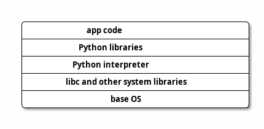

# Welcome to week five of CICF!

## The plan this week

We will go over two different topics: containers and debugging

::: {.notes}

They are separate topics.  We are discussing containers and debugging
together because we could not dedicate more time to each of them
separately.  They are both important topics.

We could be debugging containers or debugging code running inside
containers, but that is not the broad idea.  

By necessity, we will keep things short and simple. We will gloss over
some things.  But this should be enough to get you started -- you can
figure out the details when you need to learn the details.

:::

# Containers

## What are containers?

Containers are lightweight and portable environments that package an
application and its dependencies.

- Docker is popular on personal computers and commercial cloud VMs.
- Apptainer (formerly Singularity) is the standard in scientific computing, HPC, and NSF cyberinfrastructure.
- Others exist too: Podman, LXC/LXD, Kubernetes cri-o.

We will focus on Apptainer here, and see how it works with container images.

::: {.notes}

Let us look at:

- What are containers?
- What problems they solve?
- Why scientific cyberinfrastructure uses Apptainer; and
- How to use Apptainer to run programs and services.

Containers enable consistent deployment across different computing
platforms.  If your application was built and tested on some old
Debian stable version, you would be able to "containerize" it, and
then you can run it on a different machine running the latest Ubuntu,
for example.

In scientific research and HPC, Apptainer provides containerization
without requiring root permissions, making it safe and effective on
shared clusters.

:::


## Why would you use containers?

- Building software can be a brittle process.
- So can be deploying software.

Problem is having the correct versions of all the dependencies.

So we _package_ software and dependencies into _containers_.

::: {.notes}

Building and deploying software can be a brittle process.

You have some software x that is at version 1.0.2, and it needs
version 1.0.0 of library y.  But your computer has only version 0.9.8
of library y.  If you try to upgrade library y, another application z
which depends on y 0.9.8 will break.

This gets more complicated when you are deploying software on a fleet
of computers in production environments.

Sometimes multiple people or teams are involved.  There are teams of
developers who write the software on their development machines, and
then there is an operations team who install the software on
"production" machines and operate them.  Usually, there may be a
mismatch between developer environment and production environment.

When operations team complain to the developer when something does not
work, the developer would say: "it works on my machine!"

We solve this problem by "containerizing" x and its dependencies.

Containers allow us to package our applications, the runtime required
to run the application, configuration files, and any dependencies the
application needs into one artifact.

As long as there is a container runtime in the target machine, the
application works.

The host OS on the target machine could be Ubuntu 25.04, and the
container could be made using some old version of Debian stable.
Since we have "containerized the application", it will seamlessly
work.

:::

## Container images




<!-- ``` -->
<!-- +------------------------------------+ -->
<!-- | app code                           | -->
<!-- +------------------------------------+ -->
<!-- | Python libraries                   | -->
<!-- +------------------------------------+ -->
<!-- | Python interpreter                 | -->
<!-- +------------------------------------+ -->
<!-- | libc and other system libraries    | -->
<!-- +------------------------------------+ -->
<!-- | base OS                            | -->
<!-- +------------------------------------+ -->
<!-- ``` -->

::: {.notes}

Container images are "tarballs", or compressed archives of a
filesystem tree.

Container images are built "layer by layer".  Each block in the
diagram can be thought of as a layer, although that is not strictly
true.  There can be more layers, depending on how the image was built.

A layer is basically a directory tree.  Each of the layers have an id.
The id is a sha256 hash of the layer's contents.

If the same file happens to be in two layers, you will see the version
from the upper later.

By default, when you write in a container, they will go into a
temporary layer.  They will be gone when the container exits.

If you want to keep your changes, you will need to mount a directory
that is outside of the container, and write to that mounted directory.
Or you can use a docker feature called _volumes_.

:::


## A quick look at `apptainer` commands

- `apptainer build` - builds an image (`.sif`) from a definition file.
- `apptainer run` - runs the default `%runscript` of a container.
- `apptainer exec` - executes an arbitrary command in a container.
- `apptainer shell` - starts an interactive shell inside a container.
- `apptainer pull` - downloads an image (e.g. from Docker Hub) into a `.sif` file.
- `apptainer instance` - manages background services (`start`, `list`, `stop`).

::: {.notes}

Apptainer commands are straightforward and modular:
- `apptainer run <image>` runs the image's default command.
- `apptainer exec <image> <cmd>` runs any specific command inside the container.
- `apptainer shell <image>` drops you into an interactive container shell.
- `apptainer build <target.sif> <recipe.def>` compiles a new SIF file.
- `apptainer instance start/list/stop` controls background services.

:::

## What is an Apptainer Definition File?

```apptainer
Bootstrap: docker
From: python:3-slim

%files
    hello.py /hello.py

%runscript
    python /hello.py "$@"

%labels
    Author CICF
    Version v1.0
```

::: {.notes}

An Apptainer definition file (conventionally `.def`) is a plain text file
that contains the recipe for building a Singularity Image Format (`.sif`) file.

In a definition file, you specify:

- `Bootstrap: docker` and `From`: the base image from Docker Hub or OCI registry
- `%files`: files copied from host into the container
- `%post`: installation commands run during build time
- `%environment`: environment variables available at runtime
- `%runscript`: default command to execute when running the container
- `%labels`: metadata describing the image

:::


## What do you do with a `.def` file?

You build a standalone `.sif` container image, and run it!

```bash
apptainer build hello.sif hello.def
ls -lh hello.sif
apptainer run hello.sif
# Or execute it directly like a binary:
./hello.sif
```

In the tutorial we build `hello.sif` and then inspect its metadata:

```bash
apptainer inspect hello.sif
apptainer inspect --runscript hello.sif
```


## Containers under the hood

They use some Linux specific techniques:

- _cgroups_ (or "control groups") to set resource limits (such as
  memory and CPU).
- _pivot_root_ to change the root filesystem.
- _namespaces_ to allow processes to have their own network, process
  IDs, hostname, mounts, users, etc.
- _capabilities_ to give specific permissions.
- _seccomp-bpf_ to prevent dangerous system calls.
- _overlay filesystems_ to make container image layers work.

::: {.notes}

- The host operating system can see the processes in the containers.
  From the container, you can't do much in the host operating system,
  because of isolation.

- The container processes are sort of restricted: you can have a
  `root` account inside the container, but it can't do any damage to
  the host operating system.

:::

## Container registries

What happens when you do a `docker pull`?

::: {.notes}

- Remember that we used the Python base image in the example.  It was
  published by the Python Software Foundation in a container registry,
  called Docker Hub.

- Sharing container images is useful.  You help others to run your
  software.  So you publish your images in a registry such as Docker
  Hub.

- Docker Hub is a public registry.  There are others too, like
  GitHub's container registry.

- Some organizations run private registries.  My organization,
  Renaissance Computing Institute, runs a private registry.

- In order to publish, you log in to the registry with `docker login`,
  and publish your image with `docker push`.

- The images have version numbers. When you pull an image, by default,
  you will be pulling the latest version.  You can always specify a
  version if you want a different version.

:::


## A word about versioning

You could use:

- a number
- a date or a time stamp
- a commit hash
- a version string like `major.minor.patch`

See <https://semver.org/> and [Python version
specifiers](https://packaging.python.org/en/latest/specifications/version-specifiers/).

::: {.notes}

As you will keep working on your software project, you will make
releases of your project.  You will want to share your work with
others, get their feedback, add some features, fix some bugs, and
release the next version.

The releases will have some version number.  Versions indicate what
features and bugs are present in a release.

There are several ways of versioning software projects.

When working alone on a project that only you use, versioning scheme
does not matter too much.

When working in a team, or when working on a project that has public
releases, it is a good idea to use a more formal scheme such as
semantic versioning.

:::


## Running services: Apptainer Instances

A way to run background services (databases, servers, caches):

```bash
# Start a service from an image on Docker Hub
apptainer instance start docker://redis:latest redis-server

# List running background instances
apptainer instance list

# Execute commands inside the running instance
apptainer exec instance://redis-server redis-cli ping

# Stop the service
apptainer instance stop redis-server
```

::: {.notes}

- While Docker uses background daemons and `docker compose`, Apptainer
  uses **instances** to manage background services without root privileges.
- An instance runs in the background in user space.
- By default, Apptainer shares the host network namespace, so services
  like Redis immediately bind to `localhost` without requiring port mapping.
- When finished, you stop the instance with `apptainer instance stop`.

:::


## Containers and virtual machines

You can run a container inside a virtual machine but can you run a
virtual machine inside a container?

::: {.notes}

- Virtual machines run a complete operating system.
- Containers share the host OS kernel, and use its features (such as
  cgroups and namespaces) to run isolated processes.

- Containers are lightweight.

- VMs provide stronger isolation.  Since containers share resources,
  they are much more light-weight than VMs.

- VMs have some performance overhead, because of hardware
  virtualization. Containers use the host OS, and run at "native"
  speed.

- VMs are better to run different operating systems on the same
  machine. They will be isolated from each other.

:::

# Debugging

## What is a bug?

<!-- TODO: Grace hopper and the bug -->


::: {.notes}

When something does not work the way we expect, we call it a bug.  The
process of finding and fixing bugs is called debugging.

There is some interesting history behind the name "bug".

Grace Hopper was a computer scientist and a US navy rear
admiral.

While working on a working on a Mark II Computer at Harvard University
in 1947, Hopper's team found a moth that was stuck in a relay and that
was causing the computer to malfunction.

They attached the moth to the log sheet for that day with the note,
"first actual case of bug being found".

(Remember that transistores were invented in 1947. In the early days
before transistors, computers were electro-mechanical devices.)

Although they did not mention the exact phrase "debugging" in these
logs, this is a a first known instance of "debugging" a computer.  For
many decades, the term "bug" for a malfunction had been in use in
several fields before being applied to computers.

The log book with the moth can be found at the Smithsonian
Institution's National Museum of American History in Washington, D.C.

:::


## Debugging strategies

- Often the problem is the mismatch between our mental models (about
how things are supposed to work) and reality (how things actually
work).

- When debugging, we're trying to correct our mental models.

- You will create hypotheses, and test them.


## Use print statements

Add `print()` statements at various points in your code, to trace and
understand the flow of execution.

## Read the logs

- Programs (sometimes) write logs.
  - Python has a `logging` module.
- The OS keeps many logs.
  - Take a look at `/var/log`.

## Use a debugger

- Python has a `pdb` module.
- Your IDE (VS Code, PyCharm) may have a debugger built-in.
- JupyterLab has a debugger.


## Use a trace facility

Python has a `trace` module.

```
python3 -m trace --trace hello.py
```

Other tools: `strace`, `ltrace`, `dtrace`, `tcpdump`, `lsof`,
`perf`...


## Write some tests

- Writing a unit test is a good idea.
  - Or an integration test.
- It is much easier to debug code when you have tests.


## Talk to a friend

- Get a friend or colleague to review your code.
- Explain your code to the said friend or colleague.
- If no one is available, talk to a rubber duck!
  - This technique is called "rubber duck debugging", or simply
    "rubberducking".
  - <https://en.wikipedia.org/wiki/Rubber_duck_debugging>

# FIN
